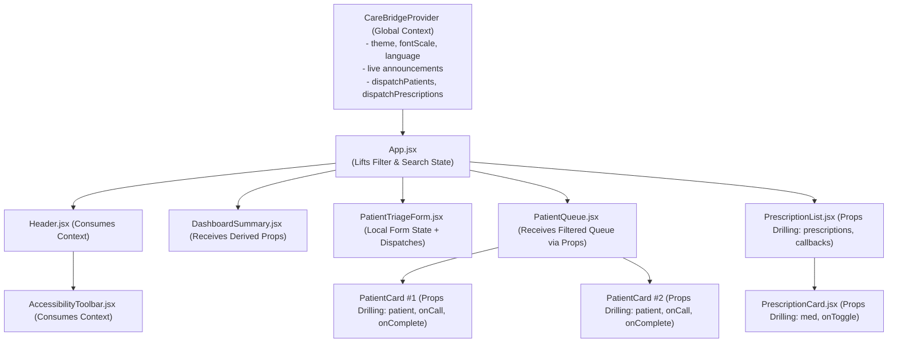

# CareBridge — Developer Guide: GitHub Workflow, NPM, and Error Handling

This guide is intended for clinical portal developers and contributors. In adherence with medical UI design rules, **no developer commands, Git instructions, or NPM details are exposed on the end-user clinical webpage (`index.html`)**.

---

## Table of Contents
1. [NPM Fundamentals & CLI Reference](#1-npm-fundamentals--cli-reference)
2. [Project Configuration & Scripts](#2-project-configuration--scripts)
3. [Step-by-Step GitHub Setup Guide](#3-step-by-step-github-setup-guide)
4. [Branching and Merging Workflow](#4-branching-and-merging-workflow)
5. [Pull Request (PR) Standard & Review Checklist](#5-pull-request-pr-standard--review-checklist)
6. [Resolving Merge Conflicts](#6-resolving-merge-conflicts)
7. [JavaScript Error Handling Architecture](#7-javascript-error-handling-architecture)
8. [Comprehensive Verification & Testing Runbook](#8-comprehensive-verification--testing-runbook)
9. [React State Management Patterns & Context API](#9-react-state-management-patterns--context-api)
10. [Styling Architecture: CSS Modules, Tailwind CSS & Styled-components](#10-styling-architecture-css-modules-tailwind-css--styled-components)

---

## 1. NPM Fundamentals & CLI Reference

NPM (Node Package Manager) coordinates libraries, build tools, and scripts for Node.js environments.

### Core CLI Commands Explained
| Command | Purpose | Explanation |
| :--- | :--- | :--- |
| `node --version` | Runtime Inspection | Prints the installed version of Node.js. |
| `npm --version` | Tooling Inspection | Prints the installed version of the NPM CLI. |
| `npm init -y` | Manifest Scaffolding | Creates a fresh `package.json` with sensible defaults. |
| `npm install` | Dependency Resolution | Reads `package.json` and installs all listed dependencies. |
| `npm install <pkg>` | Add Runtime Dependency | Downloads `<pkg>`, writes it to `node_modules/`, and adds it to `"dependencies"`. |
| `npm install -D <pkg>` | Add Dev Dependency | Downloads `<pkg>` and records it in `"devDependencies"`. |
| `npm uninstall <pkg>` | Remove Package | Removes `<pkg>` from `node_modules/` and updates manifest files. |
| `npm run <script>` | Script Execution | Executes arbitrary commands defined in `package.json` `"scripts"`. |
| `npm audit` | Security Vulnerability Scan | Scans installed dependencies against the npm security advisory database. |
| `npm ci` | Clean/Deterministic Install | Installs exact dependencies directly from `package-lock.json` (ideal for CI/CD pipelines). |

### `package.json` vs `package-lock.json`
- **`package.json`**: Human-readable configuration holding project metadata, script hooks, and semantic version ranges (e.g., `^19.3.1`).
- **`package-lock.json`**: Automatically generated snapshot containing exact dependency versions, sub-dependencies, and cryptographic sha512 integrity hashes. Ensures consistent builds across all developer machines.
- **Dependencies vs. DevDependencies**:
  - `dependencies`: Libraries required for application execution at runtime (e.g., `react`, `react-dom`, `styled-components`).
  - `devDependencies`: Tools only needed during local development, testing, or building (e.g., `vite`, `@vitejs/plugin-react`, `serve`).

---

## 2. Project Configuration & Scripts

CareBridge uses native ES Modules (`"type": "module"` in `package.json`) combined with **Vite** for near-instant Hot Module Replacement (HMR) and optimized production builds.

### Available Scripts in `package.json`
```bash
# Start Vite development server with Hot Module Replacement at http://localhost:3000
npm run dev

# Standard start command alias (runs Vite)
npm start

# Run comprehensive JavaScript syntax verification & automated unit tests
npm test

# Build production bundle into dist/ directory
npm run build

# Preview production build locally
npm run preview

# Serve legacy standalone static HTML5 version for backward compatibility
npm run serve:legacy
```

---

## 3. Step-by-Step GitHub Setup Guide

### Distinguishing Local Code vs. GitHub Account Actions

| Action | Where Performed | Tool / Location |
| :--- | :--- | :--- |
| Writing error classes & unit tests | **Local Workspace** | VS Code / Editor |
| `git init`, `git add`, `git commit` | **Local Workspace** | Local Terminal / PowerShell |
| Creating GitHub account & 2FA | **Remote Platform** | Browser at [github.com/signup](https://github.com/signup) |
| Creating `carebridge-health-portal` repository | **Remote Platform** | Browser at [github.com/new](https://github.com/new) |
| `git remote add origin ...` & `git push` | **Local Workspace** | Local Terminal |
| Opening & Merging Pull Requests | **Remote Platform** | Browser on GitHub Repository UI |

### Step 3.1: Create GitHub Account with Secure Authentication
1. Navigate to [github.com/signup](https://github.com/signup) and register with a valid email.
2. Enable Two-Factor Authentication (2FA) under **Settings > Password and authentication > Two-factor authentication**.
3. Create a Personal Access Token (PAT) under **Settings > Developer settings > Personal access tokens (classic)** with `repo` permissions, or add your SSH Public Key (`ssh-keygen -t ed25519`).

### Step 3.2: Configure Local Git Identity
```bash
git config --global user.name "Your Name"
git config --global user.email "your.email@example.com"
```

### Step 3.3: Create GitHub Repository
1. On GitHub, click **New Repository**.
2. Name: `carebridge-health-portal`.
3. Description: `Accessible Patient Triage & Multilingual Prescription Portal with ES6+ modules and structured clinical error handling.`
4. Set to **Public** or **Private**.
5. Leave "Initialize with README", ".gitignore", and "License" **unchecked** (we already have them locally).
6. Click **Create repository**.

### Step 3.4: Link Local Repo and Push
```bash
git remote add origin https://github.com/<username>/carebridge-health-portal.git
git branch -M main
git push -u origin main
```

---

## 4. Branching and Merging Workflow

1. Always branch off `main` for new features or bug fixes:
   ```bash
   git checkout main
   git pull origin main
   git checkout -b feature/context-state-styling
   ```
2. Commit changes frequently with conventional commit messages:
   ```bash
   git commit -m "feat(context): implement CareBridgeContext and reducer state machines"
   ```
3. Push branch to remote:
   ```bash
   git push -u origin feature/context-state-styling
   ```

---

## 5. Pull Request (PR) Standard & Review Checklist

Before creating a Pull Request, verify:
- [x] `npm test` passes with 18 assertions.
- [x] `npm run build` succeeds with 0 errors.
- [x] No syllabus jargon or developer commands exist inside `index.html`.
- [x] All CSS Modules are properly scoped and preserve theme switching.

---

## 6. Resolving Merge Conflicts

If git reports merge conflicts:
1. Run `git status` to see conflicting files.
2. Open files and inspect conflict markers (`<<<<<<<`, `=======`, `>>>>>>>`).
3. Resolve manually, save, stage (`git add <file>`), and commit.

---

## 7. JavaScript Error Handling Architecture

### Custom Error Class Hierarchy
```text
Error (Native JavaScript)
 └── CareBridgeError (Base Clinical Error)
      ├── ValidationError (Form inputs, biological boundaries, MRN format)
      ├── ApiError (HTTP status codes, endpoint failures, network timeouts)
      └── StorageError (Quota exhaustion, corruption, disabled storage)
```

### Key Safety Rules
1. **Never Leak PHI**: `logDiagnostic()` redacts patient names, phone numbers, MRNs, notes, and raw symptoms before writing to console.
2. **Always Reset UI in `finally`**: Buttons, spinners, and progress indicators must reset in `finally` blocks so users are never permanently locked out of the form.
3. **Graceful Fallbacks**: If `fetchMedicationSafetyData` encounters a network outage, it safely returns an offline cache without freezing the application.

---

## 8. Comprehensive Verification & Testing Runbook

### Test 1: Run Automated Unit Tests
```bash
npm test
```
*Expected Result:* 18 tests across 4 suites pass with 0 failures.

### Test 2: Build Production Bundle
```bash
npm run build
```
*Expected Result:* Vite builds `dist/` with all 46 modules transformed and zero errors.

### Test 3: Test Theme & Text Scaling Switching
1. Launch `npm run dev` and navigate to `http://localhost:3000`.
2. Click **Dark** or **High Contrast** in the top Accessibility Toolbar.
3. *Expected Result:* The document root receives `data-theme="dark"` or `data-theme="high-contrast"`. All cards, forms, and headers immediately adapt their colors according to CSS custom properties.
4. Click text size **A+** or **A++**.
5. *Expected Result:* Font scaling smoothly enlarges across the entire UI.

---

## 9. React State Management Patterns & Context API

### 9.1 Prop Drilling vs. Context API

CareBridge intentionally balances **Prop Drilling** and **Context API**:



#### Comparison & Architectural Trade-offs
| Pattern | When to Use | Advantages | Trade-offs | CareBridge Example |
| :--- | :--- | :--- | :--- | :--- |
| **Prop Drilling** | Direct parent-child communication (1–2 levels deep). | High predictability, simple component reusability, explicit contracts. | Cumbersome if passed through 4+ intermediary components. | `PatientQueue` passing patient data and `onCallPatient` to `PatientCard`. |
| **Context API** | Universal state needed by components across different branches. | Eliminates intermediate prop tunneling; centralized updates. | Inadvertent re-renders if context value is not memoized; couples components. | `CareBridgeContext` providing theme, text scale, language, and speech audio. |

### 9.2 The Five State Management Patterns

1. **Local State (`useState`)**:
   - Component-specific UI states: e.g., `searchQuery`, `activeFilter`, validation errors in `PatientTriageForm`.
2. **Lifting State Up**:
   - `App.jsx` owns the filtered queue criteria so both `DashboardSummary` and `PatientQueue` stay in sync without duplicating data.
3. **Context-Based State (`useContext`)**:
   - Persistent preferences (`theme`, `fontScale`, `language`) and live announcement broadcasts reside in `CareBridgeContext`.
4. **Derived State (`useMemo`)**:
   - Values computed directly on render from canonical arrays (e.g., `calculatePriorityCounts()`, `calculateAveragePainScore()`, `calculateAdherenceStats()`). Avoids stale or desynchronized state.
5. **Reducer-Based State (`useReducer`)**:
   - Pure state transition functions in `src/context/reducers.js`:
     ```javascript
     export function patientReducer(state, action) {
       switch (action.type) {
         case PATIENT_ACTIONS.ADD_PATIENT:
           return [action.payload, ...state];
         case PATIENT_ACTIONS.COMPLETE_PATIENT:
           return state.filter(p => p.id !== action.payload.patientId);
         case PATIENT_ACTIONS.CLEAR_QUEUE:
           return [];
         default:
           return state;
       }
     }
     ```

---

## 10. Styling Architecture: CSS Modules, Tailwind CSS & Styled-components

### 10.1 Comparative Technical Matrix

| Dimension | CSS Modules (CareBridge Production) | Tailwind CSS (Isolated Showcase) | styled-components (Isolated Showcase) |
| :--- | :--- | :--- | :--- |
| **Authoring Paradigm** | External scoped stylesheet (`Component.module.css`) | Utility class attributes in JSX (`className="p-4 flex ..."`) | CSS-in-JS tagged template literals (`styled.div\`...\``) |
| **Scoping Mechanism** | Build-time classname hashing (`_patientCard_1b4ef`) | Fixed utility classes scoped via CSS purging | Dynamic runtime `<style>` injection with unique hashes |
| **Dynamic Styles** | CSS Variables + HTML data-attributes | Conditional class strings / template literals | Native JS expressions inside template string (`${props => ...}`) |
| **Theme Support** | Seamless integration with CSS Custom Properties | Custom Tailwind config themes or CSS variables | Native `ThemeProvider` or CSS custom properties |
| **Responsive Media Queries** | Standard CSS `@media` rules within module file | Utility prefixes (`sm:`, `md:`, `lg:`, `xl:`) | Nested `@media` inside template literal |
| **Bundle & Runtime Impact** | Zero runtime overhead; single extracted CSS stylesheet | Zero runtime overhead; minimal purged CSS file | ~12kB runtime JS bundle overhead; style calculation cost |
| **Configuration in Vite** | Native out-of-the-box support with 0 plugins | Requires `@tailwindcss/vite` or PostCSS config | Requires `styled-components` npm package |
| **Primary Advantage** | Clean separation of concerns, WCAG AAA token reuse | Rapid UI prototyping, zero context switching | True component-level dynamic style logic |

### 10.2 Production Example: CSS Modules
```css
/* PatientCard.module.css */
.patientCard {
  background-color: var(--card-bg, #ffffff);
  border: 1px solid var(--border-color, #e2e8f0);
  border-radius: var(--radius-md, 10px);
  padding: 1.25rem;
  border-left: 5px solid var(--primary-500, #0ea5e9);
}

.cardUrgent {
  border-left-color: #dc2626;
  background-color: #fffafb;
}
```
```jsx
// PatientCard.jsx
import styles from './PatientCard.module.css';

export function PatientCard({ patient }) {
  const priorityClass = patient.priority === 'urgent' ? styles.cardUrgent : styles.cardRoutine;
  return <article className={`${styles.patientCard} ${priorityClass}`}>...</article>;
}
```

### 10.3 Isolated Example: Tailwind CSS
Located in [`src/examples/TailwindShowcase.jsx`](src/examples/TailwindShowcase.jsx):
```jsx
export function TailwindPatientCard({ patient }) {
  return (
    <div className="max-w-xl mx-auto my-4 bg-white rounded-xl border border-slate-200 shadow-sm p-5">
      <div className="flex items-center justify-between">
        <h4 className="text-lg font-bold text-slate-900">{patient.name}</h4>
        <span className="px-3 py-1 rounded-full text-xs font-semibold bg-red-100 text-red-800">
          ● {patient.priority}
        </span>
      </div>
    </div>
  );
}
```

### 10.4 Isolated Example: Styled-components
Located in [`src/examples/StyledComponentsShowcase.jsx`](src/examples/StyledComponentsShowcase.jsx):
```jsx
import styled, { css } from 'styled-components';

export const StyledTriageBadge = styled.span`
  display: inline-flex;
  padding: 0.25rem 0.65rem;
  border-radius: 9999px;
  font-weight: 700;

  ${(props) =>
    props.$priority === 'urgent' &&
    css`
      background-color: #fee2e2;
      color: #991b1b;
    `}
`;
```
