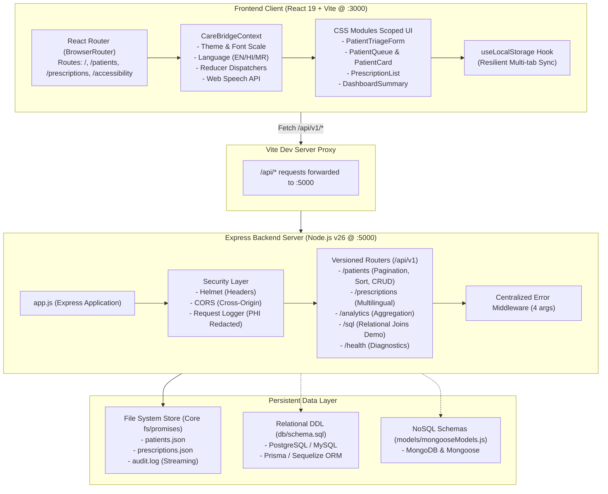

# CareBridge — Full-Stack Healthcare Portal Architecture

This document describes the high-level system architecture, client-server interactions, data flow, and security boundaries.

## Architecture Diagram

## Core Design Principles
1. **Medical UI Integrity**: The clinical portal is strictly dedicated to medical intake, triage, and multilingual prescription comprehension. No developer jargon or syllabus tables appear in the user interface.
2. **Separation of Concerns**: Production components use CSS Modules to eliminate class conflicts; backend separates app configuration (`app.js`) from port listening (`server.js`) for testability.
3. **Resilience & Graceful Degradation**: Offline fallbacks, QuotaExceeded protection, and HIPAA PHI redaction across all logs.

