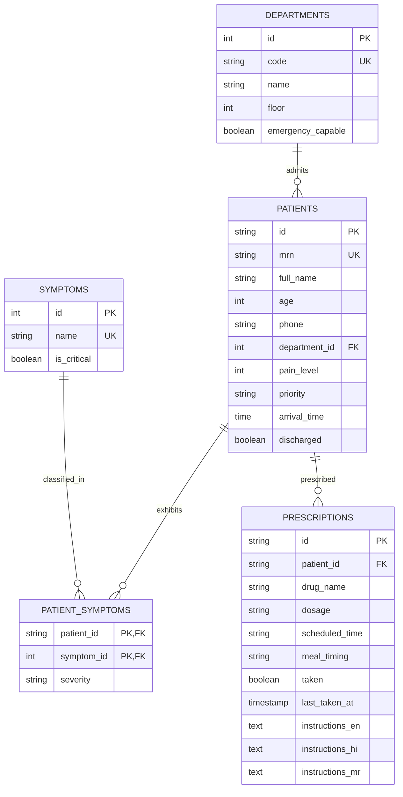

# CareBridge — Database Architecture & Data Modeling

This document details the relational database schema, ORM layers, NoSQL document models, and indexing strategies implemented in CareBridge.

---

## 1. Relational Database Design (PostgreSQL / MySQL)

### Entity-Relationship Diagram (ERD)

### Performance Indexes
- `idx_patients_priority`: B-tree index to accelerate triage queue filtering (`WHERE priority = 'urgent'`).
- `idx_patients_mrn`: Unique B-tree index for rapid medical record number lookups.
- `idx_patients_created_at`: Descending index for real-time queue ordering.
- `idx_prescriptions_patient`: Foreign key index accelerating prescription retrieval by patient ID.

---

## 2. ORM Layer (Prisma & Sequelize)

- **Prisma ([`database/prisma/schema.prisma`](../database/prisma/schema.prisma))**:
  - Declarative data model mapping.
  - Relation attributes (`@relation`) maintaining referential integrity.
  - Auto-generated type-safe database client.
- **Sequelize ([`models/sequelizeModels.js`](../models/sequelizeModels.js))**:
  - Programmatic model declaration with `sequelize.define()`.
  - Built-in data type validations and relational associations (`hasMany`, `belongsTo`).

---

## 3. NoSQL Document Store (MongoDB & Mongoose)

- **Mongoose Models ([`database/mongodb/models/`](../database/mongodb/models/))**:
  - `Patient.js`: Document schema with regex MRN validation, age bounds, virtual property `isEmergency`, and pre-save normalization.
  - `Prescription.js`: Document schema supporting multilingual instruction subdocuments (`en`, `hi`, `mr`).

